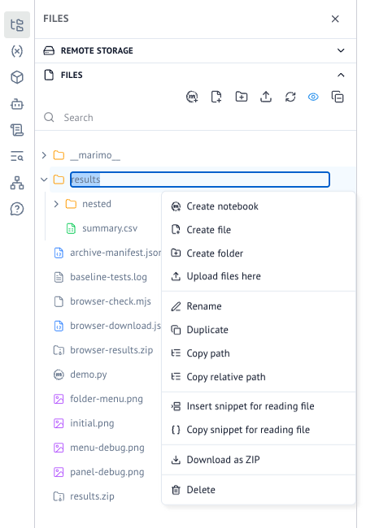

# Folder ZIP download proposal — issue #11839

Implementation: [`feat/folder-zip-download`](https://github.com/SophiaHuangCc/marimo/tree/feat/folder-zip-download), commit `5ca4b522d`.

This evidence branch is separate from the proposed upstream patch. The implementation was prepared with Codex at the repository owner's request. Maintainer approval is still required before an upstream draft PR.

## Observed browser behavior

The production-built app ran locally in edit mode. Chrome opened the folder menu and downloaded `results.zip` through the existing HTTP download endpoint. Its suggested filename was `results.zip`, with no browser download failure. The downloaded archive passed a ZIP integrity check. All five entries were checked, including the exact 256-byte binary payload and the empty directory.

The attached `results.zip` is the actual browser download and contains synthetic data only. `archive-manifest.json` records its paths and uncompressed byte lengths.

## Validation

- Python: 45 passed across `tests/_server/files/test_directory_download.py` and `tests/_server/api/endpoints/test_file_explorer.py`.
- Frontend: 131 passed across `frontend/src/components/editor/file-tree/__tests__/`.
- The two new folder-content endpoint tests fail against upstream's original endpoint with HTTP 400, then pass with the patch.
- Frontend `tsgo --noEmit` and production build passed after local LLM metadata generation.
- Changed Python files passed Ruff lint/format checks. Changed frontend files passed formatting and targeted Oxlint (two existing accessibility warnings in unchanged lines).
- Focused mypy passed for the two changed Python source files with `--follow-imports=silent --ignore-missing-imports`; core-import check passed.
- The full repository-wide `make check` was not run.

## Proposed scope requiring consensus

- A ZIP includes the selected folder as its top-level directory, with nested, hidden, and empty entries preserved.
- Symlinks and special files are omitted; symlinked directories are not traversed.
- Archives are created on disk and served through `FileResponse`, with temporary-file cleanup on completion and archive-generation errors.
- Proposed limits: 1 GiB of source bytes and 10,000 archive entries; oversize requests return HTTP 413.
- Folder downloading is offered in HTTP-backed sessions only. WASM file downloads retain their existing behavior.
- Existing edit authorization and `server.disable_file_downloads` policy apply.
