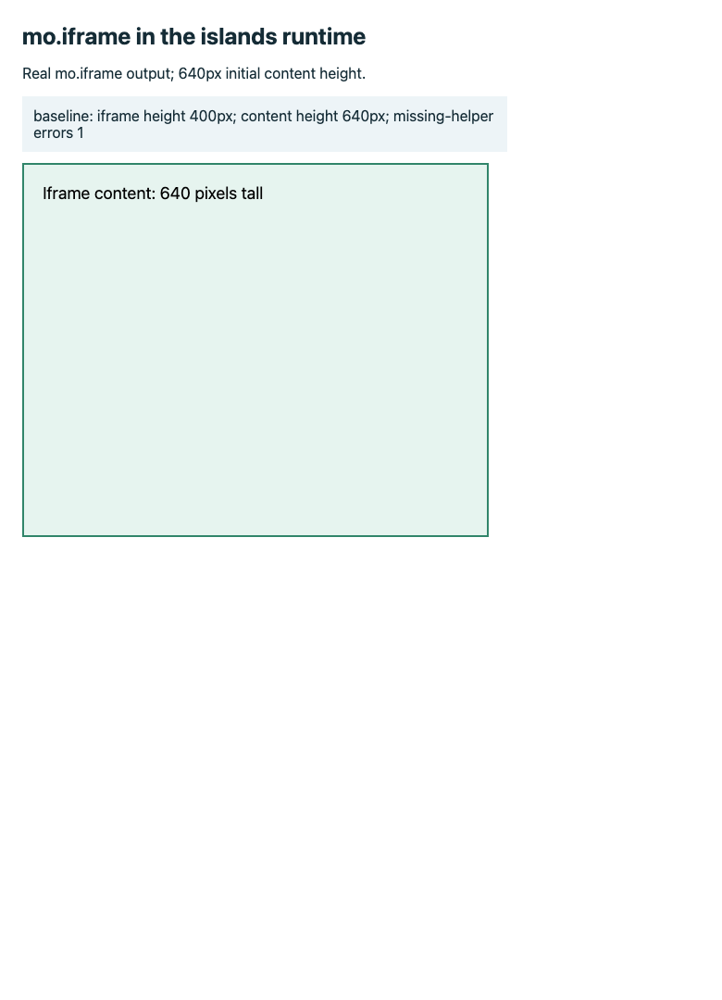
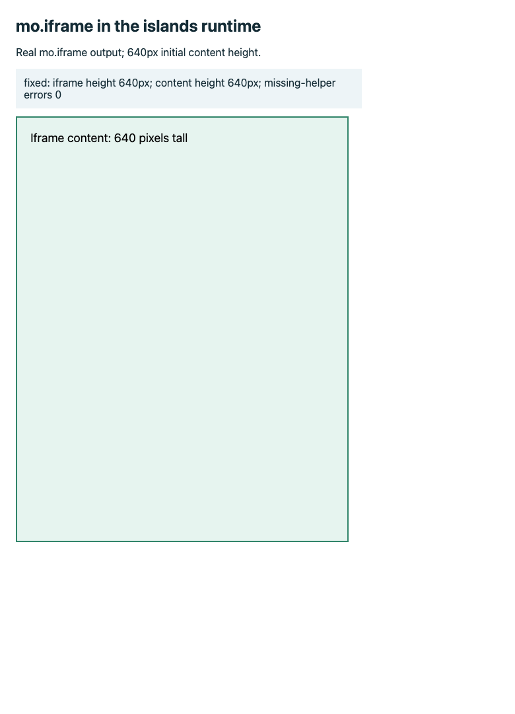

# Islands iframe resize — issue #11899

Implementation: [`fix/islands-iframe-resize`](https://github.com/SophiaHuangCc/marimo/tree/fix/islands-iframe-resize), commit `96458d8eb985cebfef025458a02a5f55f2e1295e`.
Upstream baseline: `9bdfb7605fe75aebd74ce909b83c3cbd743bd23d`.

This evidence branch is separate from the proposed code changes. Coding-agent assistance was used at the contributor's request.

## Before and after in Chrome

| Observation | Upstream bundle | Patched bundle |
|---|---:|---:|
| `typeof window.__resizeIframe` | `undefined` | `function` |
| Initial iframe client height | 400 px | 640 px |
| Initial content height | 640 px | 640 px |
| Iframe height after content grows to 920 px | 400 px | 920 px |
| Missing-helper page errors | 1 | 0 |

Before:

After:

These are actual Chrome screenshots of HTML emitted by local Python `marimo.iframe`, not mockups. The status labels reflect measurements read from the rendered iframe. `browser-observations.json` records the values and error messages; `iframe-output.html` contains the actual Python-emitted markup.

## Browser procedure and scope

1. Build upstream and patched islands bundles with `VITE_MARIMO_VERSION=0.25.2 VITE_MARIMO_ISLANDS=true vite --config islands/vite.config.mts build` from `frontend/`, using separate output directories.
2. Serve the bundles over local HTTP.
3. Import each production bundle, then insert the supplied `mo.iframe` output inside a non-reactive `marimo-island` and call the islands `initialize()` entry point.
4. Measure the iframe's height and collect missing-helper errors.
5. Change the inner content element from 640 px to 920 px, then measure again. With the patched bundle, the native `ResizeObserver` updates the iframe height.

This checks the browser-side islands/iframe integration after the bundle loads. It does not claim end-to-end Python execution in Pyodide, pre-bundle iframe-load timing, or runtime validation of Bokeh/leafmap/pyecharts.

## Automated validation

- `vitest run src/core/islands/`: 10 files, 154 tests passed.
- `vitest run src/core/islands/__tests__/main.test.ts src/core/islands/__tests__/iframe-resizer.test.ts`: 17 tests passed.
- With the original upstream entry point restored, the new helper-registration test fails (`undefined` instead of `function`); the other 11 entry-point tests pass.
- Full frontend `tsgo --noEmit`: passed.
- Production islands build: passed. Existing module-directive warnings remain.
- Targeted Oxlint and Oxfmt checks on the four changed files: passed.
- Full repository-wide `make check` and the full repository test suite were not run.
